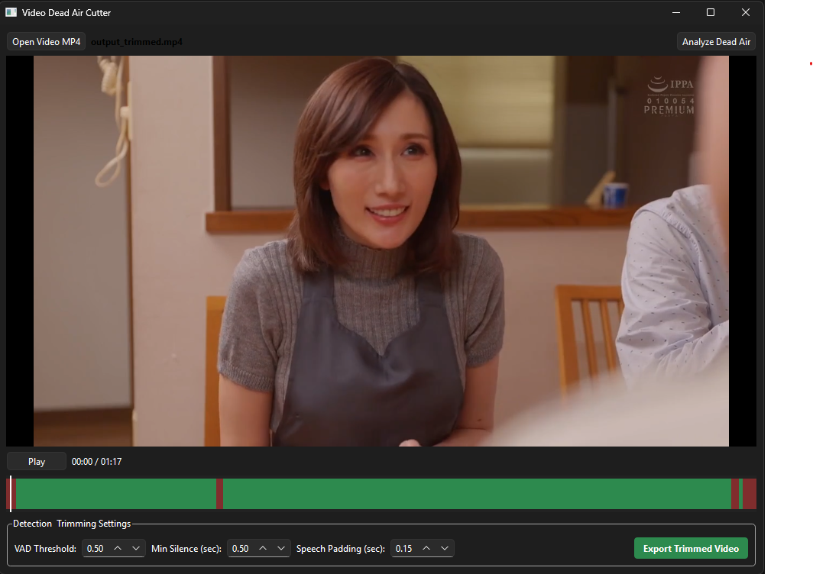

# Video Dead Air Cutter

โปรแกรม Desktop สำหรับตรวจจับและตัดช่วง Dead Air (ช่วงเงียบ/ไม่มีเสียงพูด) ในไฟล์วิดีโอ MP4 โดยอัตโนมัติด้วย AI Silero VAD (ONNX) และ PySide6 พร้อมพรีวิวและ Timeline แสดงผลแบบ Interactive



---

## คุณสมบัติเด่น (Features)
- **AI Voice Detection:** ใช้ Silero VAD (ONNX) รันบน CPU ตรวจจับเสียงพูดมนุษย์ได้แม่นยำและรวดเร็ว
- **Interactive Visual Timeline:** แถบเวลาแสดงผลชัดเจน ไฮไลต์ **สีเขียว** (ช่วงเสียงพูดที่เก็บไว้) และ **สีแดง** (ช่วง Dead Air ที่จะถูกตัดออก)
- **Integrated Video Player:** มีตัวเล่นวิดีโอในตัว คลิกหรือเลื่อนบน Timeline เพื่อ Seek ดูตำแหน่งช่วงตัดได้แบบเรียลไทม์
- **Customizable Trimming Parameters:** ปรับค่าพารามิเตอร์ได้อย่างอิสระ:
  - `VAD Threshold`: ค่าความมั่นใจในการตรวจจับเสียงพูด
  - `Min Silence (sec)`: ระยะเวลาความเงียบขั้นต่ำที่จะนับเป็น Dead Air
  - `Speech Padding (sec)`: การเผื่อขอบหัว-ท้ายเสียงพูดเพื่อป้องกันคำพูดขาดช่วง
- **Lossless Slicing & Merging:** สั่งงาน FFmpeg ตัดต่อและรวมคลิปอัตโนมัติโดยคงคุณภาพเสียงและภาพไว้สมบูรณ์

---

## วิธีติดตั้งและใช้งานสำหรับผู้ใช้ทั่วไป

### ตัวเลือกที่ 1: ติดตั้งผ่าน Windows Installer (.msi) — แนะนำ
เหมาะสำหรับผู้ใช้ทั่วไป ดาวน์โหลดไฟล์เดียวแล้วกดติดตั้งเหมือนโปรแกรมทั่วไป
1. รันไฟล์ **`build_msi.bat`** เพื่อคอมไพล์ตัวติดตั้ง
2. จะได้ไฟล์ติดตั้งที่:
   ```
   dist\VideoDeadAirCutter_Setup.msi
   ```
3. ดับเบิลคลิกไฟล์ `.msi` เพื่อติดตั้ง:
   - ติดตั้งลง `C:\Program Files\VideoDeadAirCutter` อัตโนมัติ
   - สร้างไอคอนบน **Desktop** และ **Start Menu**
   - มีระบบถอนการติดตั้ง (Uninstall) ผ่าน Windows Settings

### ตัวเลือกที่ 2: โฟลเดอร์พกพา (Portable Folder)
ไม่ต้องติดตั้ง สามารถใส่ Flash Drive เปิดใช้งานได้ทันที
1. รันไฟล์ **`build.bat`**
2. บีบอัดโฟลเดอร์ผลลัพธ์:
   ```
   dist\VideoDeadAirCutter\
   ```
3. ส่งโฟลเดอร์นี้ให้ผู้ใช้ปลายทาง ดับเบิลคลิก `VideoDeadAirCutter.exe` รันได้ทันทีโดยไม่ต้องลง Python หรือ FFmpeg

---

## สำหรับนักพัฒนา (Development)

### ข้อกำหนดระบบ (Requirements)
- Python >= 3.10
- [FFmpeg](https://ffmpeg.org/download.html) (หรือติดตั้งผ่าน `winget install Gyan.FFmpeg`)
- [uv](https://astral.sh/uv) (แนะนำ) หรือ `pip`

### การเริ่มต้นใช้งาน
```bash
# ติดตั้ง dependencies และเปิดโปรแกรมทันที
run.bat
```
หรือรันผ่าน `uv`:
```bash
uv run python main.py
```

### การทดสอบ (Run Tests)
```bash
uv run pytest
```
